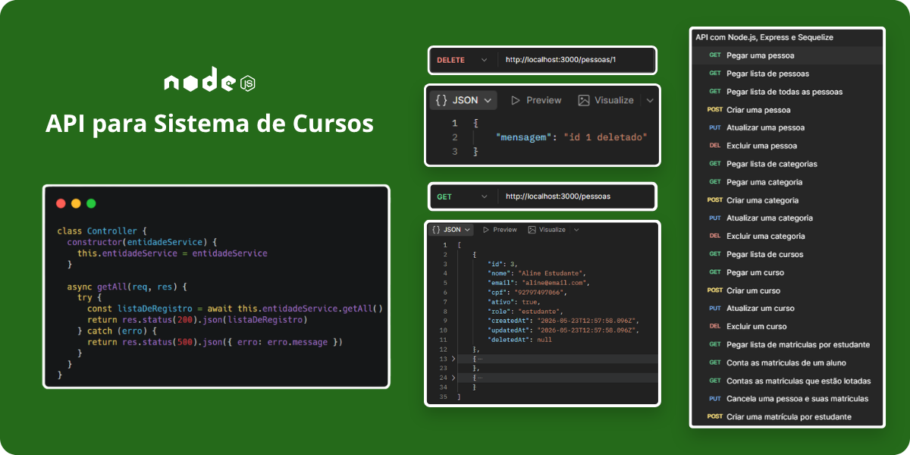

 

<div align="center">


<h1>Courses API</h1>

</div>

### Sobre o projeto:

Este projeto consiste no desenvolvimento de uma API REST utilizando Node.js, com o objetivo de gerenciar estudantes, cursos, categorias e matrículas.

A aplicação permite realizar operações CRUD, estabelecer relacionamentos entre entidades e implementar regras de negócio para o gerenciamento de matrículas e estudantes.

Este projeto faz parte dos cursos:


* [ORM com Node.js: Desenvolvendo uma API com Sequelize e SQLite](https://cursos.alura.com.br/course/orm-node-js-desenvolvendo-api-sequelize-sqlite)
* [ORM com Node.js: Avançando nas funcionalidades do Sequelize](https://cursos.alura.com.br/course/orm-node-js-funcionalidades-sequelize)

---

### Funcionalidades

#### Gerenciamento de pessoas (estudantes)

* Cadastrar estudantes.
* Consultar estudantes.
* Atualizar informações.
* Desativar registros sem exclusão definitiva.
* Consultar estudantes ativos ou todos os registros.

#### Gerenciamento de cursos

* Cadastrar cursos.
* Listar cursos.
* Atualizar informações.
* Consultar cursos por intervalo de datas.
* Excluir registros.

#### Gerenciamento de categorias

* Cadastrar categorias.
* Consultar categorias.
* Atualizar informações.
* Excluir registros.

#### Gerenciamento de matrículas

* Realizar matrículas de estudantes.
* Consultar matrículas.
* Atualizar matrículas.
* Cancelar matrículas.
* Consultar matrículas confirmadas por estudante.
* Identificar cursos com matrículas lotadas.

---

### Tecnologias utilizadas

* **Node.js:** ambiente de execução JavaScript.
* **Express:** criação e gerenciamento das rotas HTTP.
* **Sequelize:** ORM para interação com o banco de dados.
* **SQLite:** banco de dados relacional.
* **JavaScript:** desenvolvimento da lógica da aplicação.
* **Sequelize CLI:** gerenciamento de migrations e seeders.
* **Nodemon:** reinicialização automática do servidor durante o desenvolvimento.
* **ESLint:** padronização e análise do código.


---

### Como rodar o projeto

#### Pré-requisitos

Antes de começar, você precisa ter instalado:

* Node.js (LTS recomendado) — https://nodejs.org/
* npm (já vem com Node.js).
* Git — https://git-scm.com/

#### 1. Clone o repositório

```bash
git clone https://github.com/MarianSantos14/cursos-nodejs.git
cd cursos-nodejs
```

#### 2. Instale as dependências

```bash
npm install
```

#### 3. Inicie o servidor

```bash
npm run dev
```

> O servidor será iniciado na porta **3000**.

---

### Estrutura do projeto

```text
cursos-nodejs/
│
├── arquivos-base/
│   ├── colecao_postman.json
│   ├── requisitos.md
│   └── seeders e arquivos auxiliares
│
├── src/
│   ├── controllers/
│   │   ├── CategoriaController.js
│   │   ├── CursoController.js
│   │   ├── MatriculaController.js
│   │   └── PessoaController.js
│   │
│   ├── database/
│   │   ├── config/
│   │   ├── migrations/
│   │   ├── models/
│   │   ├── seeders/
│   │   └── storage/
│   │
│   ├── routes/
│   ├── services/
│   ├── utils/
│   └── app.js
│
├── .sequelizerc
├── package.json
└── server.js
```

---

## Aprendizados

* Desenvolvimento de APIs REST com Node.js e Express.
* Criação e organização de rotas HTTP.
* Arquitetura MVC e separação de responsabilidades.
* Operações CRUD.
* Mapeamento objeto-relacional (ORM) com Sequelize.
* Modelagem de dados e relacionamentos entre entidades.
* Migrations e Seeders.
* Implementação de regras de negócio.
* Validação e manipulação de dados.
* Consultas e filtros utilizando Sequelize.

---
<br>

Obs: Projeto com fins educacionais desenvolvido durante cursos da Alura.
